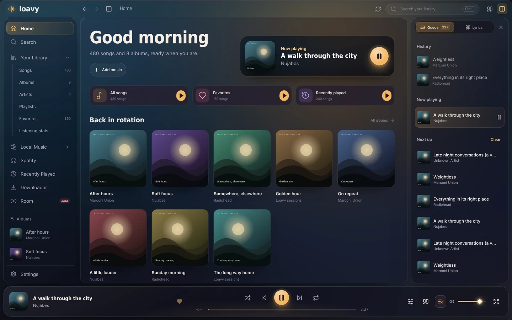
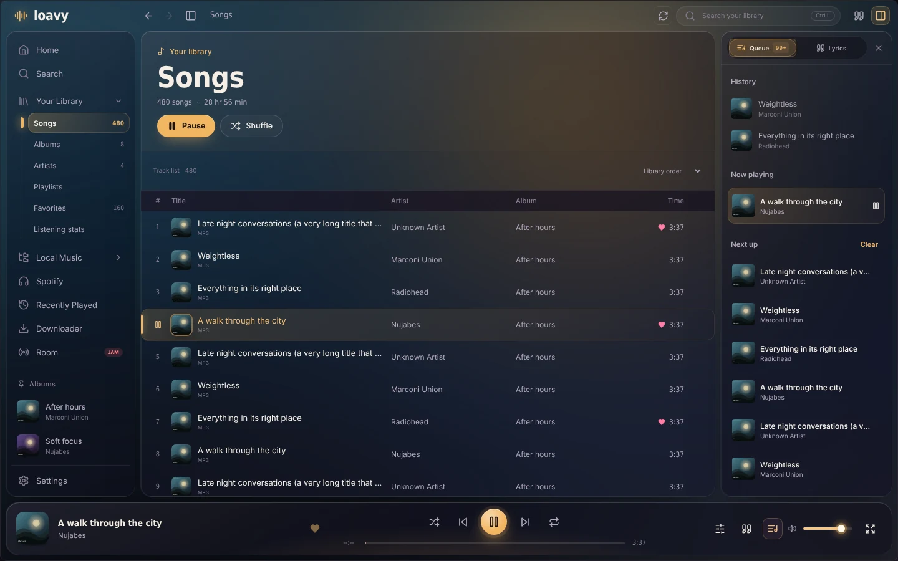
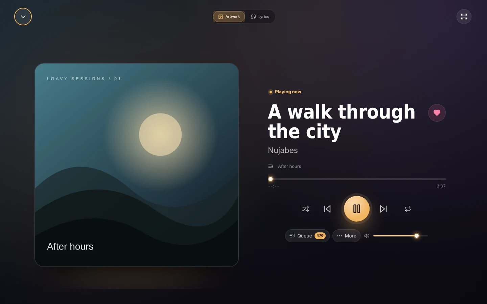
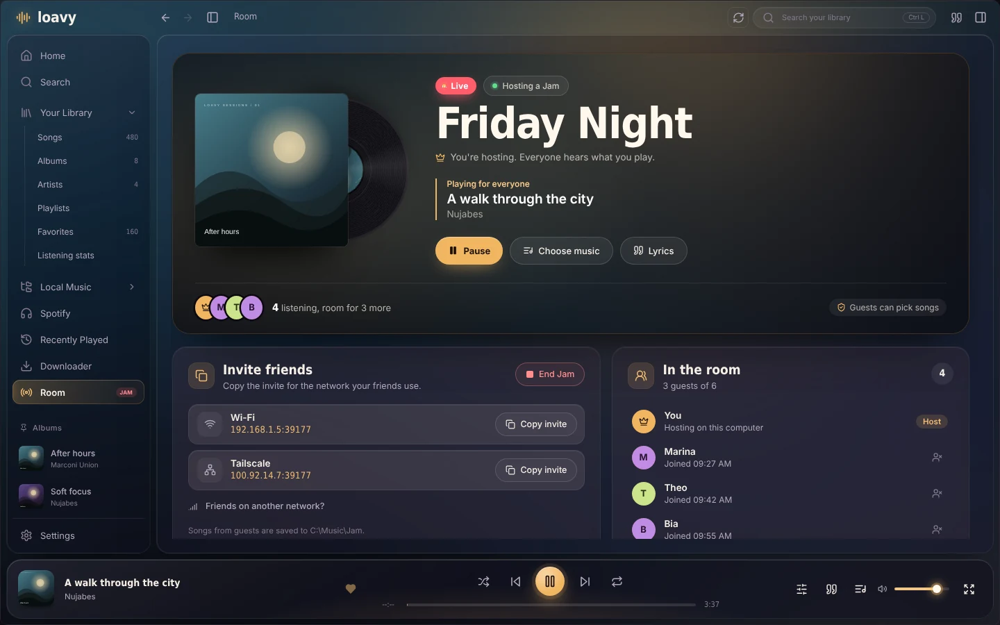
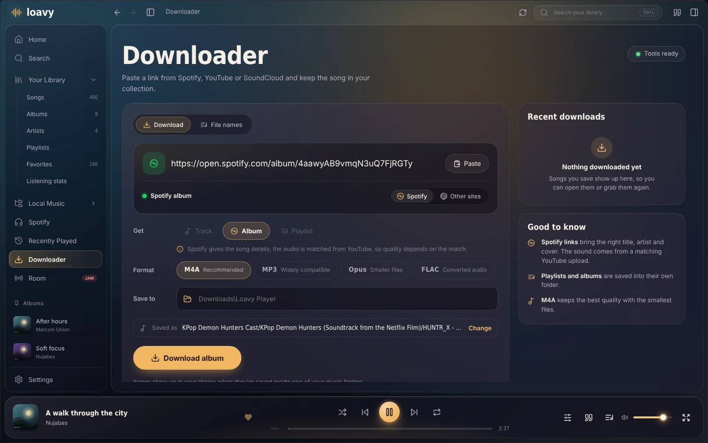
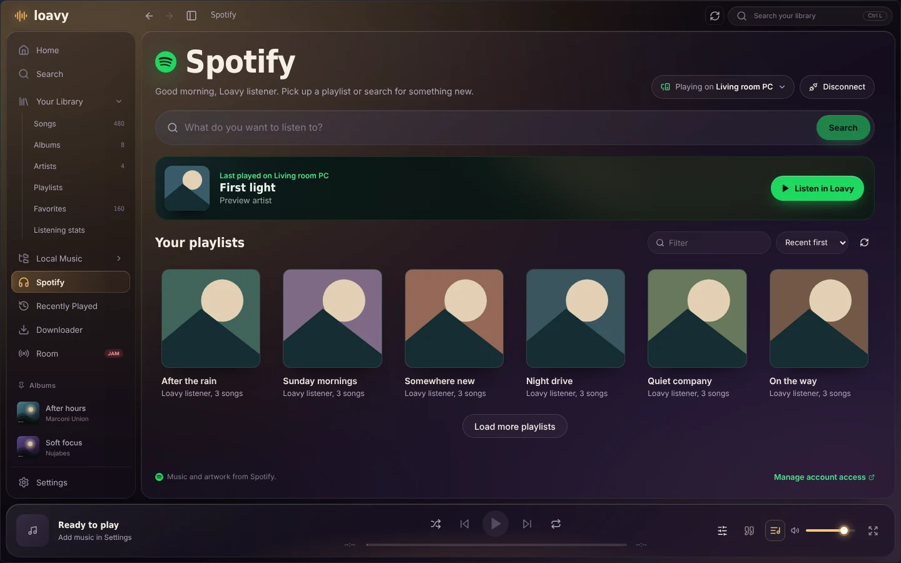
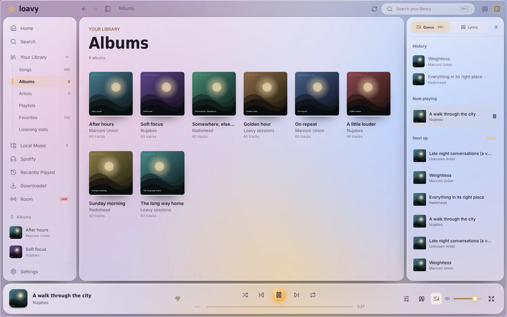

<div align="center">


# Loavy Player

**A local-first music player for Windows and Fedora Linux.**<br />
Your files, your library, your listening room. No account, no cloud, no tracking.

[](https://github.com/loavy/LoavyPlayer/releases)
[](#-windows)
[](#-fedora-linux)
[](https://v2.tauri.app/)
[](https://react.dev/)
[](https://www.rust-lang.org/)

[**Download**](https://github.com/loavy/LoavyPlayer/releases) &nbsp;|&nbsp;
[Features](#-features) &nbsp;|&nbsp;
[Guides](#-guides) &nbsp;|&nbsp;
[Build from source](#-build-from-source) &nbsp;|&nbsp;
[Troubleshooting](#-troubleshooting)

<br />



</div>

<br />

## ✨ Features

<table>
<tr>
<td width="50%" valign="top">

### 🎧 Your music, played well
- Plays **MP3, FLAC, WAV, OGG, Opus, M4A and AAC** from your own folders
- Reads tags and cover art locally, stored in a fast SQLite library
- **Gapless playback**, up to 12 s **crossfade**, 10-band **equalizer** with presets
- Albums, artists, favorites, folder playlists and custom playlist covers
- Keeps playing from the system tray when the window is closed

</td>
<td width="50%" valign="top">

### 📝 Lyrics that move with the song
- Finds synced lyrics on [LRCLIB](https://lrclib.net) and saves them offline
- **Word wave** highlight that follows the music
- Built-in editor: stamp lines or single words while you listen
- Import or export `.lrc` / `.txt`, per-song timing offset

</td>
</tr>
<tr>
<td width="50%" valign="top">

### 📻 Listen together (Jam)
- Host a password-protected room on your Wi-Fi or VPN
- Everyone hears the same second of the same song
- Guests can send songs from their own library, if you allow it
- No Loavy server in the middle: you are the host

</td>
<td width="50%" valign="top">

### ⬇️ Downloader
- Paste a link from **Spotify, YouTube, SoundCloud, Bandcamp** and more
- Recognizes the site and the link type automatically
- Saves **M4A, MP3, Opus or FLAC** with tags and artwork
- Your own file and folder naming, plus a recent downloads list

</td>
</tr>
<tr>
<td width="50%" valign="top">

### 🟢 Spotify, inside Loavy
- Connect your own Spotify developer app (Premium needed for playback)
- Browse playlists, search the catalog, pick a speaker
- Streams only; nothing from Spotify is downloaded or stored

</td>
<td width="50%" valign="top">

### 🎨 Made to look good
- **Afterglow** design with floating panels that pick up album colors
- Real **glass & blur** on Windows with an adjustable opacity
- Dark and light themes, six accent presets or any color you like
- Density, font size, high contrast and reduced motion options

</td>
</tr>
</table>

## 📸 Screenshots

<table>
<tr>
<td width="50%"><p align="center"><sub><b>Library</b>: every song, sortable, with the queue beside it</sub></p></td>
<td width="50%"><p align="center"><sub><b>Now playing</b>: artwork, controls and lyrics in full screen</sub></p></td>
</tr>
<tr>
<td width="50%"><p align="center"><sub><b>Jam</b>: a live room with listeners, invites and controls</sub></p></td>
<td width="50%"><p align="center"><sub><b>Downloader</b>: paste a link, pick a format, done</sub></p></td>
</tr>
<tr>
<td width="50%"><p align="center"><sub><b>Spotify</b>: your playlists and search, in Spotify green</sub></p></td>
<td width="50%"><p align="center"><sub><b>Glass</b>: light theme with the desktop showing through</sub></p></td>
</tr>
</table>

<sub>Screenshots use sample songs and generated artwork.</sub>

## 📦 Install

### 🪟 Windows

1. Download **`Loavy-Player-<version>-Windows-x64-Setup.exe`** from [Releases](https://github.com/loavy/LoavyPlayer/releases).
2. Run it. Setup offers optional **Tools**: choosing **Yes** opens Microsoft's free [Web Media Extensions](https://apps.microsoft.com/detail/9n5tdp8vcmhs), which adds OGG and Opus support to Windows.
3. Open Loavy and follow [First steps](#-first-steps).

### 🐧 Fedora Linux

```sh
sudo dnf install ./Loavy*.rpm
```

Launch **Loavy Player** from your applications menu. To remove it: `sudo dnf remove loavy-player` (your library data stays in your profile).

> [!NOTE]
> On Linux, playback uses WebKitGTK and your system's GStreamer codecs, so AAC/M4A may need extra codec packages. Tray playback needs a desktop with tray support (KDE Plasma, or GNOME with an AppIndicator extension). The downloader uses tools you install yourself: `yt-dlp`, `ffmpeg`, Node.js 22+ or Deno 2.3+, and `spotdl` for Spotify links.

## 🚀 First steps

1. Open **Settings** and choose **Add folder** for each place you keep music.
2. Select **Scan**. The first scan can take a while for big folders; after that, Loavy starts from its saved library.
3. Go **Home**. Pick an album, or press play on **All songs**.

Make it yours in **Settings → Appearance**: theme, accent color, glass, density and motion.

## 📖 Guides

<details>
<summary><b>🎚️ Sound: equalizer, gapless, crossfade and listening stats</b></summary>

<br />

- **Equalizer**: select the sliders icon in the player (or **Settings → Sound**). Ten bands, with Flat, Bass boost, Rock, Pop, Jazz, Electronic, Vocals and Late night presets. Moving a band makes it **Custom**. Headroom is managed automatically.
- **Gapless playback** is on by default: the next song is prepared ahead of time on the same audio clock.
- **Crossfade** overlaps songs by up to 12 seconds with equal-power curves. Set it to 0 for gapless joins without overlap.
- Very large files (over 48 MB), very long tracks or formats that can't be decoded fall back to normal playback.
- **Listening stats** (in the library sidebar) shows real listening time, plays, daily activity and your top songs, artists and albums for the week, month or year. A play counts after 30 seconds, or half of a shorter song. Everything stays in the local database.

</details>

<details>
<summary><b>🗂️ Library, playlists and folders</b></summary>

<br />

- **Folders** turns your folder structure into playlists. **Play folder** queues the folder and everything inside it.
- **Playlists** → **New playlist**, or open one and choose **Edit playlist** to set its name, description, color, cover picture and banner. Pictures (PNG, JPEG, WebP up to 12 MB) are copied into Loavy's data folder, so moving the original is fine.
- Renaming a playlist in Loavy never renames folders or moves files.
- Pin albums to the sidebar from their page. The queue and lyrics can stay docked on wide windows.
- Library search filters songs, albums and artists at once.

</details>

<details>
<summary><b>📝 Lyrics</b></summary>

<br />

- Open **Lyrics** from the player or the side panel. Loavy uses your saved lyrics first, then searches LRCLIB. Automatic matches need the same title and artist and a duration within 2 seconds, and synced lyrics are preferred.
- **Find** lets you pick another version. Click a synced line to jump there.
- **Word wave** lifts and highlights words in time. Enhanced LRC word timings are used when present; otherwise the timing is estimated across the line.
- The sliders icon holds reading options: text size, alignment, focus mode, **Search in lyrics** (Ctrl+F) and a per-song timing offset (±10 s in 0.25 s steps).
- **Edit** to fix text or add timing: put the cursor on a line and select **Stamp current time** as it plays. **Edit → Word timing** stamps single words.
- Save lyrics as `.lrc` / `.txt`, import your own, or turn online search off. **Offline mode** in Settings blocks all online lyric requests.

Only the title and artist (or your search) are sent to LRCLIB. Your audio is never uploaded.

</details>

<details>
<summary><b>📻 Listen together with a Jam</b></summary>

<br />

**Start a Jam**

1. Make sure everyone is on the same Wi-Fi, or on the same VPN (Tailscale, ZeroTier, Radmin VPN, Hamachi, WireGuard…).
2. Open **Room** → **Start a Jam**. Give it a name and a password (at least 4 characters).
3. Turn on **Guests can pick songs** if friends should be able to play songs too. Their songs are saved to a folder you choose.
4. Select **Start Jam** and allow Loavy through the Windows Firewall on private networks.
5. In **Invite friends**, select **Copy invite** for the network your friends use, and send the password separately.

**Join a Jam**

1. Open **Room** → **Join friends**.
2. Select **Search** to find Jams on your network, or **Paste invite**.
3. Enter the password and your name, then **Join Jam**. **Test connection** checks the details without joining.

**Good to know**

| | |
|---|---|
| Same computer | `127.0.0.1` |
| Same Wi-Fi / LAN | the host's Wi-Fi or Ethernet address |
| Different networks | join the same VPN and use the host's VPN address |
| Room port | TCP `39177` |
| Nearby search | UDP `39176` |

Some mesh VPNs block the nearby search; pasting the invite still works. A public internet IP is not a VPN address and usually won't work. Guests first try to play the host's song from their own library and otherwise stream the host's copy.

</details>

<details>
<summary><b>⬇️ Downloader</b></summary>

<br />

1. Open **Downloader** and paste a link (or select **Paste**). Loavy shows which site it recognized.
2. Choose what to get (a single song, an album or a playlist) when the link doesn't decide it for you.
3. Pick a **Format**: **M4A** (recommended), **MP3**, **Opus** or **FLAC**.
4. Check **Save to** (default `Downloads/Loavy Player`) and select **Download**.

The progress card shows each step (Read, Download, Convert, Tag, Save). When it's done, open the files straight from the result or from **Recent downloads**. The **File names** tab sets how files and folders are named (default `{artist} - {title}` in `{album_artist}/{album}`), with a live preview.

**Spotify links** give Loavy the right title, artist, album and cover through spotDL. The audio itself comes from a matching public YouTube upload, so quality depends on that match; FLAC can't add detail that isn't there.

On Windows, Loavy installs pinned, checksum-verified copies of yt-dlp, FFmpeg, spotDL and Deno the first time they're needed. The **Tools ready** button at the top shows their status and can repair them.

> [!IMPORTANT]
> The downloader does not bypass subscriptions, DRM, private content or region locks. Only download media you own or have permission to save, and follow each site's terms.

To see downloads in your library, save them inside one of your music folders and run **Scan**.

</details>

<details>
<summary><b>🟢 Spotify</b></summary>

<br />

This is a personal preview: you connect it with your own free Spotify developer app. Playback needs Spotify Premium, and development apps allow up to five people.

1. Create an app in the [Spotify developer dashboard](https://developer.spotify.com/dashboard) with **Web API** and **Web Playback SDK** turned on.
2. Add this redirect URI exactly: `http://127.0.0.1:43891/spotify/callback`
3. Add your account under **Users and Access**.
4. Paste the app's **Client ID** in Loavy's Spotify page and select **Connect Spotify**. Sign in in your browser, then come back.
5. Use **Playing on…** to choose where music plays: **This computer**, or any Spotify Connect device.

Sign-in uses Authorization Code with PKCE. Tokens stay in memory only, so you sign in again after restarting Loavy; only the Client ID is saved. Spotify audio stays in Spotify's own player and never reaches Loavy's EQ, stats, downloader or Jams. Start or end a Jam before switching to Spotify.

</details>

<details>
<summary><b>🎨 Appearance and glass</b></summary>

<br />

- **Theme**: dark or light. **Accent**: Honey, Rose, Lilac, Lagoon, Fern, Ember, or a custom color.
- **Glass & blur** (Windows): your desktop shows through the window with acrylic blur. **Surface opacity** controls how see-through the panels are. High contrast switches to solid surfaces.
- **Background**: **Ambient glow** (picks up the album colors), **Subtle glow** or **Solid**.
- **Density**, **font size**, **corners**, **reduced motion** and **high contrast** are all in **Settings → Appearance**.

</details>

## ⌨️ Shortcuts

| Action | Keys |
|---|---|
| Search your library | <kbd>Ctrl</kbd> + <kbd>L</kbd> |
| Back / forward | <kbd>Alt</kbd> + <kbd>←</kbd> / <kbd>→</kbd>, or mouse back/forward buttons |
| Search inside lyrics | <kbd>Ctrl</kbd> + <kbd>F</kbd> in the lyrics panel |
| Next / previous match | <kbd>Enter</kbd> / <kbd>Shift</kbd> + <kbd>Enter</kbd> |
| Move between tabs | <kbd>←</kbd> <kbd>→</kbd> <kbd>Home</kbd> <kbd>End</kbd> |
| Stamp a word while timing | <kbd>Space</kbd> on the Stamp button |

## 🛠️ Build from source

### Requirements

| | Windows | Fedora |
|---|---|---|
| Node.js | 20+ (22+ for the browser tests) | `nodejs npm` |
| Rust | stable, MSVC toolchain via [rustup](https://rustup.rs/) | `cargo rust` |
| System | [Microsoft C++ Build Tools and WebView2](https://v2.tauri.app/start/prerequisites/) | see the `dnf install` line below |

### Run it

```sh
npm install
npm run desktop:dev      # the full desktop app with hot reload
npm run dev              # frontend only, in the browser (no native features)
```

### Build installers

**Windows**

```powershell
npm run desktop:build    # NSIS installer in src-tauri/target/release/bundle/nsis/
npm run desktop:store    # Microsoft Store build with the offline WebView2 installer
```

Or double-click **`build-installer.cmd`**: it builds and copies `Loavy-Player-<version>-Windows-x64-Setup.exe` to `Downloads\Loavy Player`. The log goes to `src-tauri/target/installer-build.log`. You can pass another destination folder as the first argument.

**Fedora** (in a container, recommended for distributing to Fedora 43+)

```sh
podman build -t localhost/loavy-player-fedora -f packaging/fedora/Containerfile .
podman run --rm --userns=keep-id \
  -e CARGO_HOME=/workspace/src-tauri/target/cargo-home \
  -e CARGO_BUILD_JOBS=2 \
  -v "$PWD:/workspace:Z" localhost/loavy-player-fedora
```

Or natively:

```sh
sudo dnf install cargo rust nodejs npm gcc gcc-c++ make pkgconf-pkg-config \
  webkit2gtk4.1-devel openssl-devel libappindicator-gtk3-devel \
  librsvg2-devel libxdo-devel file rpm-build
npm ci
npm run desktop:fedora   # RPM in src-tauri/target/release/bundle/rpm/
```

### Tests

```sh
npm run build                                       # type-check and build the frontend
cargo test --manifest-path src-tauri/Cargo.toml     # Rust tests
```

The browser checks run the real interface in headless Microsoft Edge with mocked native commands. Set `DOWNLOADER_TEST_BROWSER` to use another Chromium browser. Screenshots are saved under `src-tauri/target/`.

| Command | Covers |
|---|---|
| `npm run test:playlists` | library, Home, playlists, queue, search, navigation, light theme, small windows |
| `npm run test:jam` | Jam hosting and joining, invites, permissions, lyrics, word timing |
| `npm run test:downloader` | link detection, settings, progress events, errors, file actions |
| `npm run test:spotify` | sign-in, library paging, playback, devices, offline and Jam isolation |
| `npm run test:audio` | playback, gapless joins, crossfade, equalizer, visualizer, listening stats |
| `npm run test:desktop` | launches the built Windows app and checks it starts cleanly |

None of the checks contact Spotify, YouTube or LRCLIB. A real two-computer Jam still needs a manual test.

### Project layout

```text
src/
  views/            Home, library, Room (Jam), Downloader, Spotify, Settings…
  components/       Player bar, sidebar, queue, lyrics, now playing…
  lib/              Audio engine, Tauri API client, lyrics, Spotify, navigation
  styles.css …      Base styles; later sheets layer on top, in this order:
                    redesign → desktop → audio-glass → spotify → listening-redesign
                    → afterglow (theme + glass) → jam-room → downloader → spotify-studio
src-tauri/src/
  commands.rs       Tauri command boundary
  library/          Folder scanner, tags and artwork
  db/               SQLite schema and queries
  room/             Jam host and guest protocol
  downloader/       yt-dlp and Spotify-link engines
  lyrics.rs         LRCLIB lookup
tests/              Browser harnesses (*-harness.tsx) and checks (*-browser.mjs)
packaging/fedora/   Container for RPM builds
```

## 🩺 Troubleshooting

<details>
<summary><b>A new song doesn't show up</b></summary>

Make sure it's inside one of your music folders and in a supported format, then run **Scan** again.
</details>

<details>
<summary><b>An Opus or OGG song is listed but won't play</b></summary>

On Windows, install [Web Media Extensions](https://apps.microsoft.com/detail/9n5tdp8vcmhs). On Fedora, install the GStreamer codec packages.
</details>

<details>
<summary><b>I can't find or join my friend's Jam</b></summary>

Check you're on the same Wi-Fi or the same VPN, and use the invite for that network. If **Search** finds nothing, paste the invite instead. The host may need to allow Loavy through the firewall on private networks (TCP `39177`, UDP `39176`).
</details>

<details>
<summary><b>A YouTube download says formats are missing</b></summary>

Select **Tools ready → Repair tools** on Windows. On Linux, install a current Node.js (22+) or Deno (2.3+), make sure it's on `PATH`, and restart Loavy.
</details>

<details>
<summary><b>A Spotify link finds no audio</b></summary>

Spotify links rely on a matching public upload. Private, region-locked, brand-new or unusually named songs may have no match even though they play in Spotify.
</details>

<details>
<summary><b>Some playlist songs were skipped</b></summary>

Private, deleted or region-locked entries are skipped so the rest of the playlist can finish. The result lists what couldn't be saved.
</details>

<details>
<summary><b>Spotify shows no devices</b></summary>

Open Spotify on your computer, phone or the web player, start any song, then refresh devices in Loavy. You can also pick **This computer** to play inside Loavy.
</details>

<details>
<summary><b><code>cargo</code> is not recognized, or the build mentions <code>crypto.getRandomValues</code></b></summary>

Install Rust with [rustup](https://rustup.rs/) (stable, MSVC on Windows) and use Node.js 20 or newer. Reopen the terminal and run `npm install` again.
</details>

## 🔒 Privacy

- Your music is read from your disk and never uploaded.
- Library, settings, playlists, lyrics and stats are stored on your device.
- **Offline mode** turns off online lyrics and metadata lookups.
- Jams are hosted by you; there is no Loavy server.
- The downloader only contacts the site you paste (and, for Spotify links, Spotify's catalog and the matched YouTube upload).

Read the full [privacy policy](PRIVACY.md).

## 🤝 Contributing

Keep changes focused and in line with the existing structure. Before opening a pull request, run `npm run build`, the Rust tests and the browser checks that touch your change, and add screenshots for visible interface changes.

## 📄 License

This repository doesn't include an open-source license yet, so no license is granted unless stated otherwise. © 2026 Loavy. All rights reserved.

Separately licensed tools that Loavy can download (yt-dlp, FFmpeg, spotDL) are listed in [THIRD_PARTY_NOTICES.md](THIRD_PARTY_NOTICES.md). Spotify is a trademark of Spotify AB; Loavy is not affiliated with or endorsed by Spotify.

<div align="center">
<br />
<sub>Made with 🎶 by <a href="https://github.com/loavy">Loavy</a></sub>
</div>
